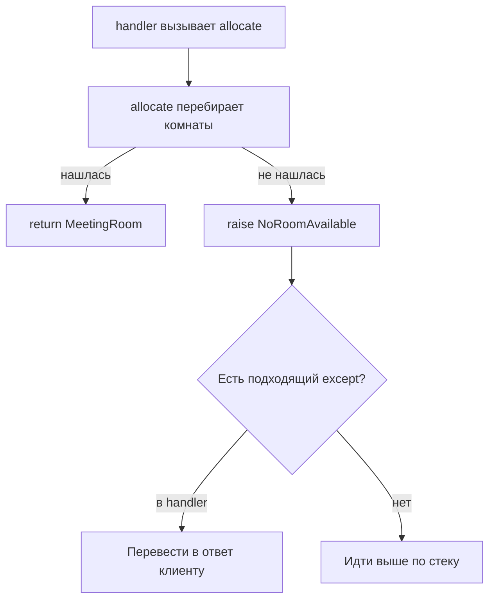

# 01 · Исключения как часть договора

**Мост:** в M1 функция `allocate` возвращала комнату или `None`. Этого хватало,
пока вызывающий код был одним учебным примером. Теперь Harbor должен
различить «подходящей комнаты нет», «строка вместимости испорчена» и
«программист обратился к несуществующему полю». Здесь делаем ошибочный путь
явным; в следующей главе научимся выдавать кандидатов лениво, по одному.

**Вопрос сюжета:** где должна родиться `NoRoomAvailable`, кто имеет право её
перехватить и почему нельзя превращать любую ошибку в «ничего страшного»?

### С собесов и из продакшена

На собеседовании спрашивают порядок `try` / `except` / `else` / `finally`,
иерархию исключений, повторный `raise` и собственные типы ошибок. В рабочем
коде важнее не синтаксис, а граница ответственности. Слишком широкий
`except` превращает настоящую поломку в ложный успех, а исключение без
контекста заставляет искать исходные данные по логам.

---

## Словарь

| Термин | English | На пальцах |
|--------|---------|------------|
| исключение | exception | Объект, который прерывает обычный путь и ищет подходящий обработчик выше по стеку |
| бросить исключение | raise an exception | Явно сообщить: текущая функция не может выполнить обещание |
| перехватить | catch | Обработать только ту ошибку, за которую этот слой действительно отвечает |
| стек вызовов | call stack | Цепочка функций от точки входа до места ошибки |
| раскрутка стека | stack unwinding | Python выходит из незавершённых вызовов, пока ищет подходящий `except` |
| цепочка исключений | exception chaining | Новая доменная ошибка сохраняет исходную причину через `raise ... from ...` |
| доменная ошибка | domain error | Ошибка на языке Harbor: «нет комнаты», а не деталь вроде `KeyError` |
| подавление ошибки | swallowing an exception | Ошибку поймали и скрыли, не восстановив корректное состояние |

Собственный класс исключения нужен не ради красивого имени. Он позволяет
вызывающему коду перехватить **ровно один смысл**, не анализируя текст
сообщения. Текст может измениться или перевестись, а тип
`NoRoomAvailable` остаётся частью договора.

---

## Модель: у функции два пути

Обычный `return` передаёт результат непосредственному вызывающему коду.
`raise` не возвращает специальное значение. Он останавливает текущий путь,
создаёт объект исключения и заставляет Python искать обработчик вверх по
цепочке вызовов.



Это важно для модели в голове: исключение не «прыгает в случайное место».
Каждый незавершённый вызов снимается со стека. Перед выходом выполняются его
блоки `finally`; затем поиск продолжается. Если обработчика нет, Python
завершает программу и печатает traceback — маршрут до места ошибки.

---

## Иерархия: ловим смысл, а не всё подряд

Упрощённая часть встроенной иерархии:

```text
BaseException
├── KeyboardInterrupt
├── SystemExit
└── Exception
    ├── ValueError
    ├── TypeError
    ├── LookupError
    │   ├── KeyError
    │   └── IndexError
    └── AllocationError          # наш класс
        └── NoRoomAvailable      # наш класс
```

Почти все ошибки прикладного кода наследуются от `Exception`.
`KeyboardInterrupt` и `SystemExit` стоят выше: пользователь должен иметь
возможность остановить программу, а команда завершения — дойти до процесса.
Поэтому `except BaseException` и голый `except:` почти всегда слишком широки.
Они могут проглотить `Ctrl+C` и сделать программу неуправляемой.

Порядок обработчиков идёт от частного к общему. Python выбирает первый
совместимый `except`:

```python
try:
    room = allocate(rooms, request)
except NoRoomAvailable as exc:
    print(f"Свободной комнаты для {exc.guest_count} гостей нет")
except AllocationError:
    print("Другая ошибка распределения")
```

Если поставить `except AllocationError` первым, ветка
`NoRoomAvailable` никогда не получит отдельной обработки: дочерний объект
уже подходит родительскому классу.

---

## `try`, `except`, `else`, `finally`

У четырёх частей разные обязанности:

```python
try:
    room = allocate(rooms, request)
except NoRoomAvailable:
    show_no_room_message()
else:
    show_room(room)
finally:
    stop_request_timer()
```

- `try` содержит **узкую операцию**, от которой ожидается конкретная ошибка.
- `except` работает, только если в `try` возник совместимый тип исключения.
- `else` выполняется, если `try` закончился без исключения.
- `finally` выполняется при успехе, при исключении и даже при раннем
  `return`; его задача — обязательное освобождение ресурса.

### Зачем нужен `else`

Можно положить `show_room(room)` внутрь `try`, но тогда тот же `except`
случайно перехватит `NoRoomAvailable`, возникшую уже в `show_room`. Это
другая операция и, возможно, другой баг. `else` уменьшает область, которую
мы согласились считать ожидаемо падающей:

```python
# Слишком широкий try: непонятно, кто именно бросил NoRoomAvailable.
try:
    room = allocate(rooms, request)
    show_room(room)
except NoRoomAvailable:
    show_no_room_message()


# Точнее: except относится только к allocate.
try:
    room = allocate(rooms, request)
except NoRoomAvailable:
    show_no_room_message()
else:
    show_room(room)
```

`else` не обязателен в каждом блоке. Он полезен, когда после рискованной
операции есть отдельный успешный шаг и вы хотите явно сузить ловушку.

### Зачем нужен `finally`

Допустим, ручной код захватил блокировку. Если между `acquire` и `release`
возникнет ошибка, блокировка не должна остаться навсегда:

```python
lock.acquire()
try:
    reserve(room)
finally:
    lock.release()
```

Для файлов и блокировок в обычном Python чаще принят контекстный менеджер:

```python
with lock:
    reserve(room)
```

`with` прячет надёжную схему входа и выхода, но не отменяет идею: ресурс
освобождается на обоих путях. Не пишите `return` в `finally`. Такой
`return` способен заменить нормальный результат и даже скрыть летящее
исключение, поэтому исходная причина исчезнет.

---

## `raise`: создать ошибку, повторить её, сохранить причину

### Доменная ошибка

Сначала назовём семейство ошибок распределения:

```python
from dataclasses import dataclass


@dataclass(frozen=True)
class MeetingRoom:
    id: str
    capacity: int


class AllocationError(Exception):
    """Базовая ошибка выбора переговорки."""


class NoRoomAvailable(AllocationError):
    def __init__(self, guest_count: int) -> None:
        self.guest_count = guest_count
        super().__init__(
            f"no meeting room is available for {guest_count} guests"
        )


def allocate(
    rooms: list[MeetingRoom],
    guest_count: int,
) -> MeetingRoom:
    if guest_count <= 0:
        raise ValueError("guest_count must be positive")

    for room in rooms:
        if room.capacity >= guest_count:
            return room

    raise NoRoomAvailable(guest_count)
```

Сигнатура теперь обещает `MeetingRoom`, а отсутствие результата выражено
отдельным путём. Это удобно, когда операция «выделить комнату» обязана
состояться или явно завершиться неуспехом. Для функции
`find_room(...) -> MeetingRoom | None`, где отсутствие — обычный результат
поиска, `None` тоже остаётся честным договором. Выбор определяется смыслом
операции, а не правилом «исключения всегда лучше».

`ValueError` у неположительного `guest_count` — другой смысл. Запрос
некорректен ещё до просмотра каталога; наличие комнат здесь ничего не
меняет. Не следует превращать его в `NoRoomAvailable`: тогда вызывающий код
решит, что запрос корректен, просто площадка заполнена.

### Повторный `raise`

Иногда слой должен записать контекст, но не умеет восстановиться:

```python
try:
    room = allocate(rooms, guest_count)
except NoRoomAvailable:
    logger.info("allocation failed", extra={"guest_count": guest_count})
    raise
```

Одинокий `raise` внутри `except` повторно бросает **то же** исключение с тем
же traceback. Запись `raise exc` тоже отправит объект выше, но изменит
видимую точку повторного броска. Когда нужно просто продолжить исходный
ошибочный путь, берите голый `raise`.

### Новая ошибка поверх технической

Сырая строка из хранилища может не превратиться в число:

```python
class InvalidRoomData(Exception):
    pass


def parse_capacity(raw: object) -> int:
    try:
        capacity = int(raw)  # type: ignore[arg-type]
    except (TypeError, ValueError) as exc:
        raise InvalidRoomData(f"invalid capacity: {raw!r}") from exc

    if capacity <= 0:
        raise InvalidRoomData("capacity must be positive")
    return capacity
```

`raise ... from exc` сохраняет обе части рассказа: верхний слой говорит
«данные комнаты невалидны», а traceback показывает исходный `ValueError`
или `TypeError`. Без цепочки техническая причина либо потеряется, либо
просочится наружу как деталь хранения.

Строка `type: ignore` здесь намеренно выделяет проблему: `int()` принимает
не любой `object`, а Pyright справедливо попросит сузить тип. В
[главе 06](./06_pyright.md) исправим путь данных вместо привычки подавлять
сообщение.

---

## Когда не надо перехватывать

Плохой обработчик узнаётся по отсутствию плана восстановления:

```python
def allocate_silently(rooms, guest_count):
    try:
        return allocate(rooms, guest_count)
    except Exception:
        return None
```

Теперь `None` означает сразу всё: нет вместительной комнаты, опечатка в
поле, ошибка программиста, неверный тип или сломанный объект. Сервис может
ответить «мест нет», хотя на самом деле код упал. Логи и traceback исчезли,
а данные выглядят правдоподобно — это опаснее явного падения.

Перехватывайте исключение, только если слой умеет сделать хотя бы одно:

1. восстановить корректное состояние и продолжить;
2. перевести известную техническую ошибку в доменный смысл, сохранив
   причину;
3. на границе приложения превратить доменную ошибку в понятный ответ;
4. добавить действительно недостающий контекст и снова бросить ошибку.

Логировать одну и ту же ошибку на каждом уровне тоже не нужно: получится
пять одинаковых записей. Обычно подробный traceback фиксирует верхняя
граница приложения, а нижние слои добавляют структурный контекст только
там, где он известен.

---

## Сухой прогон: мест нет

**Вход:**

```python
rooms = [
    MeetingRoom("A", 4),
    MeetingRoom("B", 6),
]
guest_count = 8
```

Внешний код:

```python
try:
    selected = allocate(rooms, guest_count)
except NoRoomAvailable as exc:
    message = f"Нет комнаты для {exc.guest_count} гостей"
else:
    message = f"Выбрана {selected.id}"
finally:
    timer_stopped = True
```

**Прогон:**

1. `allocate` проверяет `guest_count <= 0`: условие ложно.
2. У комнаты A `4 >= 8` ложно; `return` не выполняется.
3. У комнаты B `6 >= 8` ложно.
4. Цикл закончился, создаётся `NoRoomAvailable(8)`.
5. Обычный путь `allocate` прекращается; значение `selected` не присвоено.
6. Внешний `except NoRoomAvailable` подходит по типу и строит сообщение.
7. Блок `else` пропускается, потому что `try` не завершился нормально.
8. `finally` всё равно ставит `timer_stopped = True`.

**Выход:** `message == "Нет комнаты для 8 гостей"` и
`timer_stopped is True`.

Если заменить вход на `guest_count = 5`, комната B вернётся на третьем
шаге. Тогда `except` пропускается, `else` читает `selected.id`, а `finally`
по-прежнему выполняется.

---

## Упражнение в главе

1. Не запускайте код и проговорите четыре пути: `guest_count = 0`,
   `guest_count = 5`, `guest_count = 8` и объект комнаты без атрибута
   `capacity`. Какие типы ошибок возникают? Какие из них имеет право
   переводить обработчик «нет мест»?
2. Сохраните пример в `exceptions_lab.py`, затем сами выполните:

   ```bash
   python exceptions_lab.py
   ```

   Команда запускает именно ваш файл. Добавьте печать в `try`, `except`,
   `else` и `finally`, сравните порядок с прогнозом. После опыта уберите
   диагностическую печать: она нужна для наблюдения, а не как часть модели.

---

## Применение в Harbor

- `NoRoomAvailable` живёт рядом с доменной операцией распределения, а не в
  HTTP-обработчике.
- Граница API позже сможет перевести её в осмысленный ответ, не ловя все
  `Exception`.
- Ошибка разбора строки получает `InvalidRoomData` с исходной причиной.
- Освобождение соединения или блокировки гарантируется менеджером контекста
  либо `finally`.
- `ValueError` для невалидного запроса не маскируется под отсутствие места.

## Мини-голос

> Исключение — второй путь функции, а не специальное возвращаемое значение.
> Я бросаю доменный тип там, где нарушено обещание операции, и ловлю его на
> слое, который умеет восстановиться или перевести смысл. `else` сужает
> опасную область, `finally` освобождает ресурс на любом пути. Голый
> `except` скрывает и бизнес-отказ, и баг, поэтому ожидаемый тип ловлю узко.
> Новую ошибку связываю с исходной через `raise ... from ...`.

**Домашка пакета:** [задание 1](./homework.md) добавляет
`NoRoomAvailable` в реальный путь `allocate`.

**Дальше:** [02 · итераторы и генераторы](./02_iterators_generators.md) —
сделаем перебор комнат ленивым и увидим точный момент, когда может родиться
ошибка.

<small>Если захочешь глубже позже: `oust-psd`, тема ошибок по
[карте чтения](../../reference/reading-map.md). Для главы это чтение не
требуется.</small>
