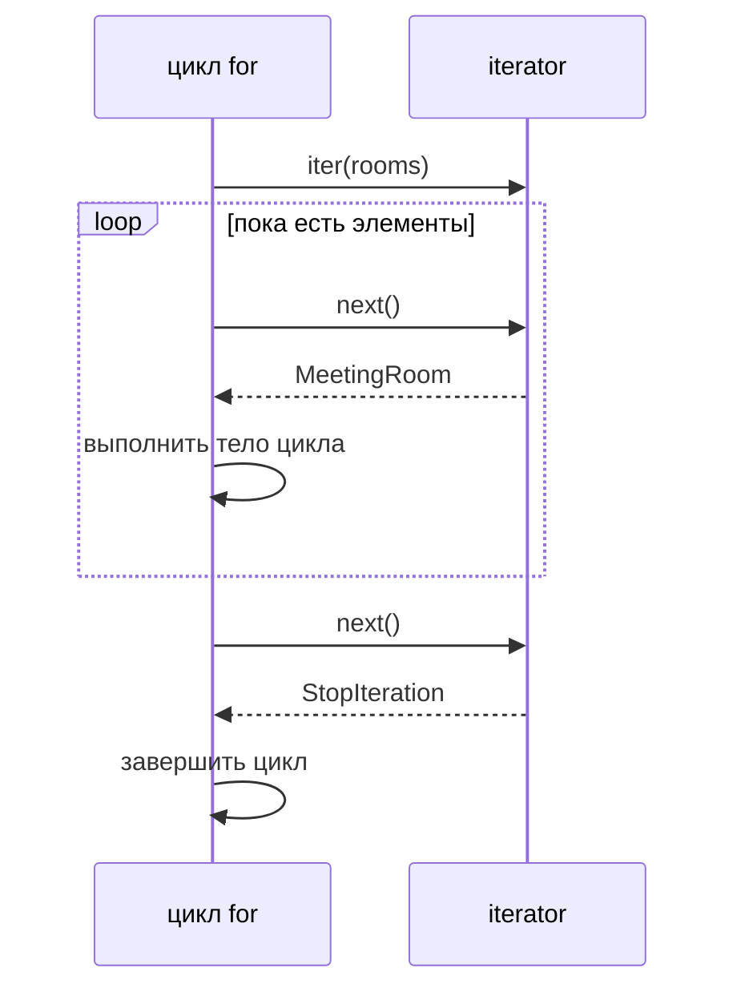

# 02 · Итераторы и генераторы: комната за комнатой

**Мост:** в [01](./01_exceptions.md) `allocate` перебирал список и бросал
`NoRoomAvailable`, когда кандидаты закончились. Но список уже целиком лежал
в памяти, а `for` выглядел как одно неделимое действие. Здесь раскроем
протокол перебора и заменим заранее собранный результат ленивым потоком. В
следующей главе научимся аккуратно передавать параметры и преобразовывать
коллекции.

**Вопрос сюжета:** как Harbor может запросить следующую подходящую комнату,
остановиться после первой и не вычислять остальной каталог?

### С собесов и из продакшена

Частые вопросы: «чем iterable отличается от iterator», «что делает `for`»,
«когда начинает выполняться генератор», «можно ли пройти генератор дважды».
В работе эта модель нужна для чтения файлов, строк из БД и больших ответов:
ленивость экономит память и позволяет остановиться раньше, но переносит
ошибку с момента создания потока на момент его потребления.

---

## Словарь

| Термин | English | На пальцах |
|--------|---------|------------|
| итерируемый объект | iterable | Из него можно получить новый обход через `iter(...)` |
| итератор | iterator | Объект с состоянием текущей позиции; `next(...)` даёт следующий элемент |
| протокол итерации | iteration protocol | Договор методов `__iter__` и `__next__` |
| конец потока | `StopIteration` | Сигнал от итератора: следующего элемента больше нет |
| генераторная функция | generator function | Функция с `yield`; вызов создаёт генератор, но не выполняет тело целиком |
| генератор | generator | Итератор, состояние которого Python хранит между `yield` |
| ленивый | lazy | Значение вычисляется только тогда, когда его запросили |
| жадный | eager | Вся коллекция вычисляется сразу |

Список — **iterable**, но не **iterator**: по одному списку можно начать два
независимых обхода. Генератор — iterator и обычно одноразовый: он уже хранит
текущую позицию, поэтому повторный проход не начинает историю сначала.

---

## Модель: `for` под капотом

Цикл:

```python
for room in rooms:
    print(room.id)
```

можно мысленно раскрыть так:

```python
iterator = iter(rooms)

while True:
    try:
        room = next(iterator)
    except StopIteration:
        break
    else:
        print(room.id)
```

`iter(rooms)` вызывает `rooms.__iter__()` и получает объект обхода.
`next(iterator)` вызывает `iterator.__next__()`. Когда элементы
закончились, `__next__` не возвращает особую метку вроде `None`: он бросает
`StopIteration`. Цикл `for` ловит именно этот служебный сигнал и нормально
завершается.



`StopIteration` здесь не означает сбой каталога. Это часть протокола,
сравнимая со знаком «конец данных». Однако вне `for` вы обязаны либо
обработать этот конец, либо использовать `next(iterator, default)`.

---

## Руками: собственный итератор

Ручной класс нужен, чтобы увидеть состояние, которое генератор позже спрячет:

```python
from dataclasses import dataclass


@dataclass(frozen=True)
class MeetingRoom:
    id: str
    capacity: int


class RoomCursor:
    def __init__(self, rooms: list[MeetingRoom]) -> None:
        self._rooms = rooms
        self._index = 0

    def __iter__(self) -> "RoomCursor":
        return self

    def __next__(self) -> MeetingRoom:
        if self._index >= len(self._rooms):
            raise StopIteration

        room = self._rooms[self._index]
        self._index += 1
        return room
```

У `RoomCursor` два элемента состояния: ссылка на каталог и индекс следующей
комнаты. После каждого `next` индекс сдвигается. `__iter__` возвращает
`self`, потому что объект уже является собственным одноразовым обходом:

```python
rooms = [MeetingRoom("A", 2), MeetingRoom("B", 6)]
cursor = RoomCursor(rooms)

assert iter(cursor) is cursor
assert next(cursor).id == "A"
assert next(cursor).id == "B"
# next(cursor)  # StopIteration
```

Для обычного списка картина другая:

```python
first_walk = iter(rooms)
second_walk = iter(rooms)
assert first_walk is not second_walk
```

Два итератора делят сами объекты комнат, но хранят независимые позиции.
Если каталог мутировать во время обхода, поведение может удивить: индексы
сдвигаются, а итератор не делает автоматический снимок. Границы мутации
разберём в [главе 04](./04_copy_mutability.md).

---

## Принято: генераторная функция

Ручной `RoomCursor` многословен для простого фильтра. `yield` позволяет
написать тот же автомат состояний обычным на вид циклом:

```python
from collections.abc import Iterable, Iterator


def suitable_rooms(
    rooms: Iterable[MeetingRoom],
    guest_count: int,
) -> Iterator[MeetingRoom]:
    if guest_count <= 0:
        raise ValueError("guest_count must be positive")

    for room in rooms:
        if room.capacity >= guest_count:
            yield room
```

Из-за наличия `yield` вызов `suitable_rooms(rooms, 5)` **не запускает тело**
как обычная функция. Он создаёт объект генератора. Проверка
`guest_count <= 0`, вход в цикл и первое сравнение произойдут лишь при
первом `next` или при начале `for`.

```text
вызов suitable_rooms(...) ──> объект generator
                                  │
                             next │ продолжить
                                  ▼
                             код до yield
                                  │
                    отдать room и заморозить кадр
                                  │
                             next │ продолжить после yield
                                  ▼
                         следующий проход цикла
```

«Заморозить кадр» означает сохранить локальные переменные и место остановки.
После `yield room` функция не начинает работу заново. Следующий `next`
возвращает управление на строку **после** `yield`, затем цикл идёт дальше.
Когда функция доходит до конца, Python превращает обычное завершение в
`StopIteration`.

Автоматика пишет класс итератора и хранит индекс неявно. Она не решает за
нас, можно ли повторно читать источник, что делать с ошибкой посередине и
кто владеет открытым ресурсом.

---

## Ленивость меняет момент работы

Добавим наблюдаемую печать только для учебного опыта:

```python
def traced_suitable_rooms(
    rooms: Iterable[MeetingRoom],
    guest_count: int,
) -> Iterator[MeetingRoom]:
    print("генератор начал работу")
    for room in rooms:
        print("проверяю", room.id)
        if room.capacity >= guest_count:
            yield room
```

```python
rooms = [
    MeetingRoom("A", 2),
    MeetingRoom("B", 6),
    MeetingRoom("C", 10),
]

candidates = traced_suitable_rooms(rooms, 5)
print("генератор создан")
first = next(candidates)
print("выбрана", first.id)
```

Ожидаемый порядок:

```text
генератор создан
генератор начал работу
проверяю A
проверяю B
выбрана B
```

Комната C пока вообще не проверялась. Если Harbor нужна только первая
подходящая переговорка, ранняя остановка — не трюк производительности, а
точное выполнение договора «возьми первую».

У этой отложенности есть цена. Ошибка внутри тела тоже возникает не при
создании `candidates`, а при потреблении:

```python
bad = suitable_rooms(rooms, 0)  # объект успешно создан
next(bad)                       # здесь ValueError
```

Поэтому `try` должен окружать тот `next` или цикл, где поток реально
двигается. Перехват только вокруг вызова генераторной функции ничего не
поймает.

---

## `allocate` поверх генератора

Публичной операции нужна одна комната, а вспомогательный генератор умеет
перечислить все подходящие:

```python
class NoRoomAvailable(Exception):
    def __init__(self, guest_count: int) -> None:
        self.guest_count = guest_count
        super().__init__(f"no room for {guest_count} guests")


def allocate(
    rooms: Iterable[MeetingRoom],
    guest_count: int,
) -> MeetingRoom:
    for room in suitable_rooms(rooms, guest_count):
        return room
    raise NoRoomAvailable(guest_count)
```

Здесь `for` удобнее ручного `next`: если генератор пуст, цикл просто не
войдёт в тело, после чего выполнится доменный `raise`. Служебный
`StopIteration` не просачивается в API Harbor.

Можно написать `next(suitable_rooms(...))`, поймать `StopIteration` и
перевести его в `NoRoomAvailable`, но такой вариант добавляет техническое
исключение без пользы. Ручной способ важен для понимания; принятый код
оставляет намерение «вернуть первый или бросить доменную ошибку» видимым.

---

## Сухой прогон генератора

**Вход:** A на 2 места, B на 6, C на 10; `guest_count = 5`.

```python
candidates = suitable_rooms(rooms, 5)
first = next(candidates)
second = next(candidates)
```

1. Первая строка создаёт генератор. Тело функции ещё не выполнялось.
2. Первый `next` проверяет `5 <= 0`: ложно.
3. Цикл получает A; `2 >= 5` ложно, `yield` пропущен.
4. Цикл получает B; `6 >= 5` истинно.
5. `yield` отдаёт B. Состояние останавливается внутри цикла перед следующим
   проходом.
6. Второй `next` продолжает после первого `yield` и получает C.
7. `10 >= 5` истинно; наружу отдаётся C.
8. Третий `next` исчерпал бы источник и получил `StopIteration`.

**Выход:** `first.id == "B"`, `second.id == "C"`. A была проверена, но не
отдана; повторно она уже не появится.

Если теперь выполнить `list(candidates)`, получится пустой список: тот же
генератор уже стоит после C. Чтобы начать сначала, нужно **снова вызвать**
`suitable_rooms`, если исходный `rooms` допускает повторный обход.

---

## Генераторное выражение — лёгкий случай

Простой фильтр можно записать выражением:

```python
candidates = (
    room
    for room in rooms
    if room.capacity >= guest_count
)
```

Круглые скобки создают ленивый генератор. Квадратные скобки создали бы
готовый список:

```python
eager_candidates = [
    room
    for room in rooms
    if room.capacity >= guest_count
]
```

Генераторное выражение хорошо читается для одного преобразования и одного
простого условия. Если нужны валидация, несколько веток, логирование или
объясняющие имена промежуточных шагов, обычная генераторная функция яснее.
Краткость не компенсирует потерянный смысл.

Осторожно с агрегатами: `sum(...)`, `list(...)`, `set(...)` и
`sorted(...)` потребляют весь поток. Ленивый источник перед ними не
гарантирует малую память: например, `list(generator)` специально собирает
все элементы.

---

## Упражнение в главе

1. На бумаге раскройте `for room in suitable_rooms(rooms, 5)` через
   `iter()` и `next()`. Отдельно назовите, кто создаёт `StopIteration`, кто
   его ловит и почему `NoRoomAvailable` — уже другой уровень смысла.
2. Сохраните пример с диагностической печатью в `generators_lab.py`.
   Сначала выполните только создание генератора, затем добавляйте по одному
   `next` и каждый раз запускайте:

   ```bash
   python generators_lab.py
   ```

   До запуска запишите ожидаемые строки. После второго элемента попробуйте
   пройти тот же генератор ещё раз и объясните пустой результат без слова
   «Python почему-то запомнил».

---

## Применение в Harbor

- Каталог из файла или БД можно обрабатывать строка за строкой, не создавая
  второй полный список.
- `allocate` останавливает источник после первой подходящей комнаты.
- Отдельный `suitable_rooms` пригоден для интерфейса «показать все варианты».
- Ошибка ленивого источника возникает во время `next`, поэтому границу
  `try` ставят вокруг потребления.
- Одноразовый генератор нельзя молча сохранить и ожидать два независимых
  отчёта.

## Мини-голос

> Iterable умеет создать обход, iterator хранит позицию и отдаёт следующий
> элемент. `for` вызывает `iter`, повторяет `next` и завершает работу по
> `StopIteration`. Функция с `yield` создаёт генератор, а тело начинает
> выполнять только потребитель. После `yield` локальные переменные
> сохраняются. Генератор экономит работу до запроса, но обычно одноразовый,
> а его ошибки возникают во время чтения.

**Домашка пакета:** [задание 2](./homework.md) требует ленивый поток комнат
и тест, доказывающий раннюю остановку.

**Дальше:** [03 · аргументы, распаковка и включения](./03_args_comprehensions.md) —
разберём, как данные попадают в функции и когда короткая запись действительно
помогает чтению.

<small>Если захочешь глубже позже: `fluent-py`, темы итераторов и функций
как объектов по [карте чтения](../../reference/reading-map.md). Внешнее
чтение не требуется.</small>
