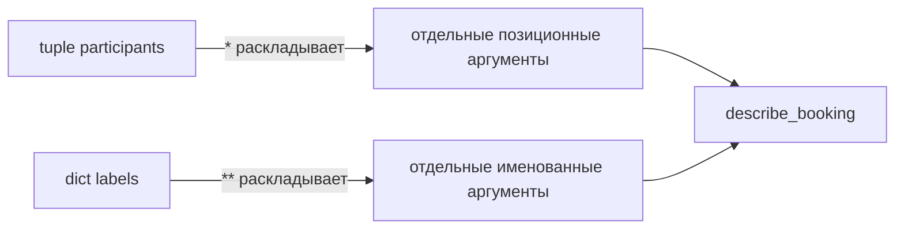

# 03 · Аргументы, распаковка и включения

**Мост:** генератор из [02](./02_iterators_generators.md) отделил источник
комнат от способа их потребления. Теперь у Harbor растёт число входов:
обязательные параметры запроса, дополнительные признаки комнаты и словари
из внешней границы. Здесь разберём, как Python связывает аргументы с
параметрами и как кратко преобразовывать коллекции, не превращая код в
ребус. Дальше посмотрим, какие из этих значений делят одни и те же
изменяемые объекты.

**Вопрос сюжета:** как сделать вызов `allocate` удобным, но оставить его
договор видимым и не спрятать бизнес-логику в одну плотную строку?

### С собесов и из продакшена

На собеседовании просят объяснить разницу между `*args`, `**kwargs` и
распаковкой при вызове, а затем написать list/dict comprehension. Рабочая
ошибка обычно не в забытом синтаксисе. Опаснее публичная функция, которая
принимает «что угодно», или включение с тремя условиями, где ревьюер не
замечает неверную ветку.

---

## Словарь

| Термин | English | На пальцах |
|--------|---------|------------|
| аргумент | argument | Конкретное значение в месте вызова: `allocate(rooms, 5)` |
| параметр | parameter | Имя в объявлении функции: `guest_count` |
| позиционный | positional | Связывается по месту слева направо |
| именованный | keyword | Связывается по имени: `guest_count=5` |
| сбор аргументов | argument packing | `*args` собирает остаток в `tuple`, `**kwargs` — в `dict` |
| распаковка | unpacking | `*values` или `**mapping` раскладывает контейнер в отдельные аргументы |
| только именованный | keyword-only | Параметр после `*`; его имя обязательно видно в вызове |
| списковое включение | list comprehension | Короткое построение списка из прохода и простого условия |
| словарное / множественное включение | dict/set comprehension | Та же идея для пар ключ–значение или уникальных элементов |

Одинаковые символы `*` и `**` меняют смысл по контексту. В объявлении они
**собирают** оставшиеся аргументы. В вызове они **раскладывают** контейнер.
Слово «распаковка» для обоих мест встречается часто, но мысленная модель
«объявление собирает, вызов раскладывает» точнее предсказывает результат.

---

## Модель: как Python связывает вызов

Возьмём диагностическую функцию:

```python
def describe_booking(
    room_id: str,
    *participants: str,
    projector: bool = False,
    **labels: str,
) -> str:
    return (
        f"room={room_id}; participants={participants}; "
        f"projector={projector}; labels={labels}"
    )
```

Вызов:

```python
text = describe_booking(
    "A-101",
    "Анна",
    "Борис",
    projector=True,
    floor="5",
    team="harbor",
)
```

связывается так:

```text
"A-101" ------------------------> room_id
"Анна", "Борис" -- * собирает --> participants == ("Анна", "Борис")
projector=True -----------------> projector
floor="5", team="harbor"
                 -- ** собирает -> labels == {"floor": "5", "team": "harbor"}
```

`participants` всегда кортеж, даже если дополнительных позиционных
аргументов нет. `labels` всегда новый словарь для этого вызова. Имя `args`
или `kwargs` — соглашение, а не синтаксис: звёздочка работает и у
`*participants`. Осмысленное имя часто лучше объясняет договор.

Аннотация `*participants: str` относится к **каждому** собранному элементу,
а `**labels: str` — к каждому значению словаря. Ключи у `**kwargs` являются
строками, потому что приходят как имена аргументов.

---

## `*` как граница публичного договора

Не всегда нужно собирать произвольные значения. Одинокая `*` делает
следующие параметры только именованными:

```python
from collections.abc import Iterable


def allocate(
    rooms: Iterable[MeetingRoom],
    *,
    guest_count: int,
    required_tags: tuple[str, ...] = (),
) -> MeetingRoom:
    ...
```

Вызов читается как предложение:

```python
room = allocate(
    rooms,
    guest_count=6,
    required_tags=("projector",),
)
```

Без имён `allocate(rooms, 6, ("projector",))` заставляет помнить порядок
двух похожих по роли значений. После `*` Python отвергнет такой вызов
`TypeError`, и ошибка станет видна сразу. Здесь ограничение делает API
яснее, а не менее удобным.

`*args` и `**kwargs` не нужно добавлять «на будущее». Если функция принимает
произвольные ключи, опечатка `guest_cont=6` может тихо попасть в `kwargs`
вместо немедленной ошибки о неизвестном параметре. Кроме того, Pyright хуже
проверяет широкий словарь, чем явную сигнатуру. Для доменной операции Harbor
предпочтительны названные параметры; сбор остатка нужен у обёрток,
адаптеров и действительно открытых наборов меток.

---

## Распаковка при вызове

Теперь символы работают в обратную сторону:

```python
participants = ("Анна", "Борис")
labels = {"floor": "5", "team": "harbor"}

text = describe_booking(
    "A-101",
    *participants,
    projector=True,
    **labels,
)
```

`*participants` отдаёт элементы как два отдельных позиционных аргумента.
`**labels` отдаёт пары как именованные аргументы. Ключи отображения обязаны
быть строками и должны совпадать с допустимыми именами либо попасть в
`**kwargs`.



Если один параметр передать дважды, Python не выбирает «последний»:

```python
options = {"projector": True}

# TypeError: multiple values for keyword argument 'projector'
describe_booking("A-101", projector=False, **options)
```

Это отличается от сборки нового словаря:

```python
defaults = {"projector": False, "floor": "4"}
overrides = {"projector": True}
effective = {**defaults, **overrides}

assert effective == {"projector": True, "floor": "4"}
```

В словарном литерале более поздний ключ заменяет ранний. В вызове
дублирование одного параметра считается неоднозначностью и приводит к
`TypeError`.

---

## Распаковка при присваивании

Звёздочка умеет собрать «середину» последовательности:

```python
route = ["lobby", "A-101", "B-202", "roof"]
start, *stops, finish = route

assert start == "lobby"
assert stops == ["A-101", "B-202"]
assert finish == "roof"
```

В отличие от `*args`, переменная `stops` здесь получает **список**. Такой
приём полезен, когда структура действительно имеет первый и последний
элемент. Если смысл элементов не следует из положения, лучше работать с
именованными полями модели: распаковка не добавляет доменного смысла сама.

---

## Включения: преобразовать один проход

Включение состоит из трёх частей: что положить, откуда брать и при каком
условии:

```text
[ room.id       for room in rooms       if room.capacity >= 6 ]
  что положить    откуда брать             когда положить
```

### Список

```python
large_room_ids = [
    room.id
    for room in rooms
    if room.capacity >= 6
]
```

Результат сохраняет порядок исходного обхода и может содержать повторы.
Всё вычисляется сразу, поэтому это готовый список, а не ленивый поток.

### Словарь

```python
rooms_by_id = {
    room.id: room
    for room in rooms
}
```

Если два объекта имеют одинаковый `id`, более поздний тихо заменит ранний.
Иногда это желаемая политика, но для Harbor дубликат идентификатора скорее
нарушает инвариант каталога. Тогда обычный цикл с явной проверкой лучше:

```python
rooms_by_id: dict[str, MeetingRoom] = {}

for room in rooms:
    if room.id in rooms_by_id:
        raise ValueError(f"duplicate room id: {room.id}")
    rooms_by_id[room.id] = room
```

Словарное включение короче, но не умеет объяснить, почему потеря первого
объекта допустима. Если потеря недопустима, краткость скрывает ошибку.

### Множество

```python
capacities = {
    room.capacity
    for room in rooms
}
```

`set` оставляет уникальные значения и не обещает порядок, пригодный для
бизнес-логики. Это подходит для вопроса «какие вместимости существуют», но
не для «какая комната была первой».

---

## Когда не надо сжимать код

Слишком плотное включение заставляет одновременно держать в голове
фильтрацию, нормализацию, выбор значения и особый случай:

```python
# Трудно проверить на ревью.
labels = {
    room.id: ",".join(sorted(tag.lower() for tag in room.tags if tag))
    for room in rooms
    if room.capacity >= guest_count and room.active
}
```

Обычный цикл длиннее по строкам, но даёт имена шагам и место для проверки:

```python
labels: dict[str, str] = {}

for room in rooms:
    if not room.active or room.capacity < guest_count:
        continue

    normalized_tags = [
        tag.lower()
        for tag in room.tags
        if tag
    ]
    labels[room.id] = ",".join(sorted(normalized_tags))
```

Здесь простое внутреннее включение ещё читается: один источник, одно
преобразование, одно условие. Наружный цикл объясняет бизнес-ветку. Правило
не в количестве `for`, а в цене расшифровки: если строке нужно отдельное
устное объяснение, дайте шагам имена в коде.

Включение также не предназначено для побочных эффектов:

```python
# Плохо: список результатов не нужен, важна скрытая печать.
[print(room.id) for room in rooms]

# Честно:
for room in rooms:
    print(room.id)
```

---

## Сухой прогон: сбор и распаковка

Выполним:

```python
participants = ("Анна", "Борис")
labels = {"floor": "5"}

result = describe_booking(
    "A-101",
    *participants,
    projector=True,
    **labels,
)
```

1. `*participants` превращается в два позиционных значения после
   `"A-101"`.
2. Первый позиционный аргумент связывается с `room_id`.
3. Остаток `"Анна"`, `"Борис"` собирается в кортеж `participants`.
4. `projector=True` связывается с явным keyword-only параметром.
5. `**labels` создаёт именованный аргумент `floor="5"`.
6. Явного параметра `floor` нет, поэтому пара собирается в словарь
   `labels`.
7. Функция строит строку; исходные кортеж и словарь не меняются.

**Выход:**

```text
room=A-101; participants=('Анна', 'Борис'); projector=True; labels={'floor': '5'}
```

Теперь мысленно добавьте в исходный `labels` ключ `"projector"`. Вызов
упадёт до входа в тело функции: параметр `projector` получил бы значение
дважды.

---

## Упражнение в главе

1. Напишите на бумаге результат для вызовов
   `describe_booking("A")`,
   `describe_booking("A", "Ира", floor="2")` и
   `describe_booking("A", *["Ира"], **{"team": "core"})`.
   Для каждого значения покажите стрелкой, в какой параметр оно попало.
2. Возьмите одно включение из своего Harbor. Если в нём больше одного
   условия или вложенный `for`, перепишите обычным циклом и прочитайте оба
   варианта вслух. Сохраните опыт в `args_lab.py` и запустите:

   ```bash
   python args_lab.py
   ```

   Выберите вариант не по числу строк, а по тому, где легче назвать
   инвариант и место возможной ошибки.

---

## Применение в Harbor

- `*` делает `guest_count` и `required_tags` видимыми по имени в вызове.
- `*args` / `**kwargs` уместны в прозрачной обёртке, которая передаёт вызов
  дальше, но доменная функция сохраняет явную сигнатуру.
- `**mapping` помогает на границе, только если ключи уже проверены; сырой
  JSON не становится безопасным от одной распаковки.
- List comprehension строит небольшой готовый список идентификаторов.
- Dict comprehension годится лишь тогда, когда политика дубликатов
  осознана.
- Set comprehension отвечает на вопрос об уникальных признаках, но не
  сохраняет смысл «первая комната».

## Мини-голос

> В объявлении `*` и `**` собирают остаток, в вызове раскладывают контейнер.
> `*args` становится кортежем, `**kwargs` — словарём строковых ключей.
> Одинокая `*` делает важные параметры только именованными. Включение удобно
> для одного ясного преобразования; сложные ветки оставляю обычному циклу.
> Краткость полезна, пока инвариант и политика дубликатов остаются видны.

**Домашка пакета:** [задание 3](./homework.md) закрепляет распаковку и
преобразование каталога без плотного «однострочника».

**Дальше:** [04 · ссылки, копии и мутация](./04_copy_mutability.md) — узнаем,
почему новый список с теми же комнатами не всегда является независимым
снимком.

<small>Если захочешь глубже позже: `fluent-py`, темы последовательностей,
отображений и функций как объектов по
[карте чтения](../../reference/reading-map.md). Для сдачи достаточно
материала главы.</small>
