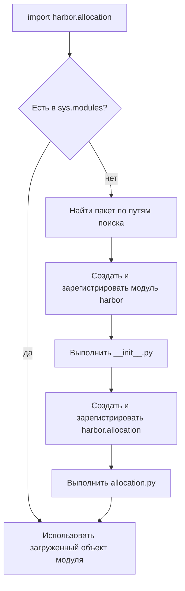

# 05 · Модули и пакеты: границы Harbor

**Мост:** в [04](./04_copy_mutability.md) мы разделили неизменяемое описание
комнаты и изменяемое расписание. Пока все имена живут в одном файле, эта
граница существует только в голове. Здесь разнесём модели, ошибки и
распределение по модулям и сами соберём пакет. В следующей главе Pyright
пройдёт по этим импортам и проверит общий договор.

**Вопрос сюжета:** как разложить Harbor по файлам так, чтобы импорт показывал
направление зависимости, а запуск не зависел от случайной текущей
директории?

### С собесов и из продакшена

На собеседовании спрашивают разницу между модулем и пакетом, роль
`__init__.py`, абсолютные и относительные импорты, значение `__name__`.
В работе чаще болит другое: файл запускают напрямую, относительный импорт
падает; в `__init__.py` спрятан тяжёлый побочный эффект; два модуля
импортируют друг друга и видят наполовину созданные имена.

---

## Словарь

| Термин | English | На пальцах |
|--------|---------|------------|
| модуль | module | Один загруженный файл Python и его пространство имён |
| пакет | package | Модуль-контейнер, внутри которого есть подмодули и подпакеты |
| пространство имён | namespace | Соответствие имён объектам внутри модуля |
| импорт | import | Найти модуль, выполнить его верхний уровень при первой загрузке и связать имя |
| абсолютный импорт | absolute import | Полный путь от верхнего пакета: `harbor.models` |
| относительный импорт | relative import | Путь от текущего пакета: `.models` |
| точка входа | entry point | Модуль или функция, с которой начинается сценарий |
| кэш модулей | `sys.modules` | Уже загруженные модули; повторный import обычно не выполняет файл заново |
| циклический импорт | circular import | A ждёт B, а B во время загрузки ждёт ещё не готовый A |

Модуль нужен не просто для уменьшения длины файла. Он даёт отдельное
пространство имён и направление зависимости. Когда `allocation` импортирует
`MeetingRoom` из `models`, читатель видит: операция зависит от модели, а
модель не обязана знать про сценарий распределения.

---

## Модуль, пакет и обычная директория

Файл `models.py` можно импортировать как модуль `models`, если его родитель
доступен в пути поиска Python. Директория `harbor/` с `__init__.py` становится
обычным явным пакетом:

```text
harbor/
├── __init__.py
├── models.py
├── errors.py
├── allocation.py
└── app.py
```

Современный Python поддерживает namespace packages без `__init__.py`, но
для первого собственного пакета явный файл полезнее: структура однозначна,
а читатель видит границу пакета. Namespace package решает отдельную задачу —
распределить один логический пакет по нескольким директориям или
дистрибутивам. Harbor сейчас этого не требует.

`__init__.py` — полноценный модуль `harbor`. Его код выполняется при первом
`import harbor`. Поэтому пустой файл — нормальное начало. Не нужно сразу
заполнять его импортами, подключением к БД или настройкой логов.

---

## Модель: что происходит при `import`

Упрощённая модель:



Детали реализации сложнее: объект модуля помещается в кэш ещё до полного
выполнения, чтобы импорт мог отслеживать циклы. Для практики важны четыре
следствия:

1. верхний уровень модуля выполняется при первом импорте;
2. повторный импорт в том же процессе обычно берёт объект из кэша;
3. код с побочными эффектами на верхнем уровне срабатывает во время импорта;
4. при цикле второй модуль может увидеть первый ещё не до конца
   инициализированным.

Объявления классов и функций на верхнем уровне ожидаемы. Отправка письма,
соединение с БД или запуск сервера — плохой сюрприз для обычного импорта.

---

## Сначала направление зависимостей

До создания файлов нарисуем разрешённые стрелки:

```text
app ───────────────┐
 │                 │
 ├──> allocation ──┼──> models
 │        │        │
 │        └────────┴──> errors
 └────────────────────> models / errors

models и errors не импортируют app или allocation
```

Нижние модули ничего не знают о точке входа. Благодаря этому модели можно
импортировать в тестах, скриптах и будущем HTTP-слое без запуска приложения.
Если `models.py` импортирует `allocation.py`, а тот импортирует
`models.py`, образуется цикл. Обычно это сигнал, что общую модель или тип
нужно вынести ниже, а не лечить перестановкой строк.

---

## Собираем пакет руками

Не копируйте готовый каркас из генератора: задача упражнения — связать
каждый файл с его ответственностью.

### Шаг 1. Убедиться, где вы находитесь

Пакет должен лежать внутри корня вашего `harbor-capstone`. Сначала
посмотрите текущую директорию:

```bash
pwd
```

Команда ничего не создаёт. Она печатает абсолютный путь, чтобы следующая
команда не построила `harbor/` внутри случайной папки. Если вы не в корне
репозитория, перейдите туда своей командой `cd`.

### Шаг 2. Создать границу пакета

Когда путь проверен, сами создайте директорию и файлы:

```bash
mkdir -p harbor
touch harbor/__init__.py
touch harbor/models.py harbor/errors.py harbor/allocation.py harbor/app.py
```

`mkdir -p` создаёт директорию, если её нет, и не ругается, если она уже
существует. `touch` создаёт пустые файлы. Это не готовое приложение:
назначение и содержимое каждого модуля вы добавляете дальше сами.

На этом шаге не нужен `pyproject.toml`, CI или генератор проекта. Мы
изучаем механизм пакета на минимальной структуре; упаковку и установку
приложения добавляют только под реальную задачу.

### Шаг 3. Модели не знают сценарий

В `harbor/models.py`:

```python
from dataclasses import dataclass


@dataclass(frozen=True, slots=True)
class MeetingRoom:
    id: str
    capacity: int
    tags: tuple[str, ...] = ()

    def __post_init__(self) -> None:
        if self.capacity <= 0:
            raise ValueError("capacity must be positive")
```

Модель проверяет собственный инвариант, но не выбирает себя из каталога и
не печатает ответ пользователю.

### Шаг 4. Ошибка на языке домена

В `harbor/errors.py`:

```python
class AllocationError(Exception):
    """Базовая ошибка распределения переговорок."""


class NoRoomAvailable(AllocationError):
    def __init__(self, guest_count: int) -> None:
        self.guest_count = guest_count
        super().__init__(f"no room for {guest_count} guests")
```

Этот модуль не зависит от моделей. Ошибка хранит только контекст, нужный
вызывающему коду.

### Шаг 5. Операция импортирует нижние понятия

В `harbor/allocation.py`:

```python
from collections.abc import Iterable, Iterator

from .errors import NoRoomAvailable
from .models import MeetingRoom


def suitable_rooms(
    rooms: Iterable[MeetingRoom],
    guest_count: int,
) -> Iterator[MeetingRoom]:
    if guest_count <= 0:
        raise ValueError("guest_count must be positive")

    for room in rooms:
        if room.capacity >= guest_count:
            yield room


def allocate(
    rooms: Iterable[MeetingRoom],
    guest_count: int,
) -> MeetingRoom:
    for room in suitable_rooms(rooms, guest_count):
        return room
    raise NoRoomAvailable(guest_count)
```

Точка в `.models` означает «модуль `models` внутри текущего пакета».
Относительный импорт удобен для тесно связанных соседей, но работает только
когда Python понимает пакетный контекст. Это станет видно на шаге запуска.

Абсолютный вариант тоже корректен:

```python
from harbor.errors import NoRoomAvailable
from harbor.models import MeetingRoom
```

Он явно показывает полный путь и легче ищется по проекту. В одном пакете
выберите согласованный стиль. Не смешивайте варианты для лечения случайных
ошибок запуска и не добавляйте вручную пути в `sys.path`.

### Шаг 6. Точка входа управляет сценарием

В `harbor/app.py`:

```python
from .allocation import allocate
from .errors import NoRoomAvailable
from .models import MeetingRoom


def main() -> None:
    rooms = [
        MeetingRoom("A", 4),
        MeetingRoom("B", 8, ("projector",)),
    ]

    try:
        room = allocate(rooms, guest_count=6)
    except NoRoomAvailable as exc:
        print(f"Нет комнаты для {exc.guest_count} гостей")
    else:
        print(f"Выбрана комната {room.id}")


if __name__ == "__main__":
    main()
```

Защитное условие отделяет определение от запуска. При импорте
`harbor.app` функция `main` создаётся, но сценарий не стартует. При запуске
этого модуля как точки входа `__name__` равен `"__main__"`, и `main()`
вызывается.

### Шаг 7. Запустить именно модуль пакета

Из родительской директории, где видна папка `harbor/`, выполните:

```bash
python -m harbor.app
```

Флаг `-m` просит Python найти модуль по пакетному имени и запустить его.
Ожидаемый вывод:

```text
Выбрана комната B
```

Не запускайте этот файл так:

```bash
python harbor/app.py
```

При прямом запуске `app.py` становится отдельным скриптом без известного
родительского пакета. Относительный импорт `.allocation` не знает, «от чего»
считать точку, и возникает ошибка вида `attempted relative import with no
known parent package`. Проблема не в точке как таковой, а в неверном способе
запуска пакетного модуля.

---

## Что класть в `__init__.py`

Начните с пустого файла. Когда публичный API стабилизируется, пакет может
осознанно переэкспортировать несколько имён:

```python
from .allocation import allocate
from .errors import NoRoomAvailable
from .models import MeetingRoom

__all__ = ["MeetingRoom", "NoRoomAvailable", "allocate"]
```

Тогда клиент пишет:

```python
from harbor import MeetingRoom, allocate
```

Но это решение увеличивает ответственность `__init__.py`: импорт
`harbor` теперь загрузит все три модуля, а не только пустую границу.
Переэкспорт полезен, когда он создаёт маленький устойчивый API. Не следует
перетаскивать туда каждое внутреннее имя.

`__all__` управляет тем, что попадёт в `from harbor import *`; он не делает
остальные объекты приватными. Подчёркивание `_helper` остаётся соглашением
«внутренняя деталь», а настоящая граница держится на том, что клиентский код
не зависит от этой детали.

---

## Циклический импорт на пальцах

Пусть `models.py` импортирует `allocate`, а `allocation.py` импортирует
`MeetingRoom`:

```text
1. Python начал models.py
2. models.py попросил allocation.py
3. allocation.py попросил MeetingRoom из models.py
4. models.py уже есть в sys.modules, но строка class MeetingRoom
   могла ещё не выполниться
5. имя MeetingRoom недоступно: импорт падает
```

Перенос импорта внутрь функции иногда откладывает проблему, но не исправляет
архитектурный цикл. Сначала спросите, почему нижняя модель знает о верхнем
сценарии. В нашем графе стрелки идут в одну сторону, поэтому такой цикл не
возникает.

Для аннотаций, которым нужен тип без runtime-импорта, существуют строковые
аннотации и `TYPE_CHECKING`, но не используйте их как ширму над запутанными
зависимостями. В M1b достаточно сначала построить простой однонаправленный
граф.

---

## Сухой прогон `python -m harbor.app`

1. Текущая директория попадает в путь поиска модулей.
2. Python находит директорию `harbor` и выполняет её `__init__.py`.
3. Затем начинает `harbor.app`; его `__name__` для запуска равен
   `"__main__"`, а пакетный контекст остаётся `harbor`.
4. Импорт `.allocation` загружает `harbor.allocation`.
5. Тот импортирует `harbor.errors` и `harbor.models`; их классы создаются и
   модули попадают в кэш.
6. Управление возвращается в `app.py`; определяется `main`.
7. Условие `__name__ == "__main__"` истинно, запускается сценарий.
8. `allocate` выбирает B, `else` печатает результат.

Повторные импорты `harbor.models` в этом процессе используют тот же объект
модуля из `sys.modules`; класс не объявляется заново при каждом `import`.

---

## Упражнение в главе

1. Создайте пакет **сами** шаг за шагом и после каждого файла объясните его
   ответственность одним предложением. Запустите сначала правильную
   команду:

   ```bash
   python -m harbor.app
   ```

   Затем намеренно попробуйте прямой запуск `python harbor/app.py`,
   прочитайте ошибку и вернитесь к пакетному запуску. Не исправляйте ошибку
   добавлением `sys.path`.
2. Нарисуйте граф импортов своего Harbor. Если есть две встречные стрелки,
   назовите понятие, которое лежит не на своём уровне, прежде чем переносить
   строки.

---

## Применение в Harbor

- `models.py` хранит инварианты данных и не запускает сценарии.
- `errors.py` даёт стабильные доменные типы ошибок.
- `allocation.py` зависит от моделей и ошибок, но не от CLI или будущего
  HTTP-слоя.
- `app.py` связывает части и переводит доменный исход в вывод пользователю.
- Пакет запускается через `python -m harbor.app` из его родительской
  директории.
- `__init__.py` остаётся пустым, пока не нужен осознанный небольшой API.

## Мини-голос

> Модуль — файл и его пространство имён, пакет — модуль с подмодулями.
> Первый import выполняет верхний уровень, последующие обычно используют
> `sys.modules`, поэтому импорт не место для скрытого запуска приложения.
> Стрелки зависимостей идут от точки входа к операциям и моделям, но не
> обратно. Относительный импорт требует пакетного контекста, поэтому модуль
> запускаю через `python -m`, а не как случайный файл.

**Домашка пакета:** [задание 5](./homework.md) просит вручную собрать эту
структуру в вашем Harbor и приложить граф импортов.

**Дальше:** [06 · Pyright](./06_pyright.md) — установим проверяющий
инструмент своими руками и пройдём его сообщения от модели до точки входа.

<small>Если захочешь глубже позже: `oust-psd`, темы сложности и границ
модулей по [карте чтения](../../reference/reading-map.md). Это необязательная
глубина после практики.</small>
