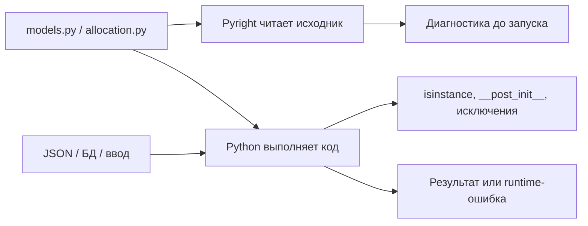

# 06 · Pyright руками: аннотации становятся проверкой

**Мост:** в [05](./05_packages.md) Harbor получил модули с явными импортами,
а модели и функции уже несут аннотации из M1. Пока эти аннотации читали
только люди и редактор. Здесь самостоятельно установим Pyright, запустим его
на пакете и пройдём цикл «сообщение → путь данных → исправление». В следующей
главе применим ту же дисциплину к незнакомому коду, где готовых объяснений
нет.

**Вопрос сюжета:** как отличить реальную дыру в договоре Harbor от шума
проверяющего инструмента и исправить причину, а не скрыть сообщение?

### С собесов и из продакшена

На собеседовании полезно объяснить, зачем статические типы нужны
динамическому Python и почему они не заменяют валидацию. В работе Pyright
ловит несогласованный возврат, неразобранный `None` и сырой `dict` до
запуска. Но зелёная проверка не гарантирует корректные данные, а
`# type: ignore` способен сделать проблемное место невидимым.

---

## Словарь

| Термин | English | На пальцах |
|--------|---------|------------|
| статическая проверка | static type checking | Чтение исходника без выполнения бизнес-сценария |
| время выполнения | runtime | Момент, когда Python реально получает значения и исполняет код |
| вывод типа | type inference | Pyright сам вычисляет тип выражения по операциям и веткам |
| сужение типа | type narrowing | После проверки `is None` или `isinstance` возможных типов становится меньше |
| несовместимый тип | incompatible type | Обещан один набор операций, а значение поддерживает другой |
| `Any` | dynamic escape hatch | «Не проверяй это значение»: операции проходят почти без контроля |
| `Unknown` | unknown type | Pyright не смог узнать тип и в строгом режиме просит уточнение |
| строгий режим | strict mode | Дополнительные правила против неявных и неизвестных частей договора |
| диагностическое правило | diagnostic rule | Имя категории сообщения, например `reportOptionalMemberAccess` |

Pyright не «добавляет типы в Python». Он строит отдельную модель программы
и проверяет, согласуются ли пути значений с аннотациями. При запуске
обычный интерпретатор по-прежнему получает реальные объекты и выполняет
runtime-проверки.

---

## Модель: два маршрута одного исходника



Pyright может увидеть, что функция обещает `MeetingRoom`, но иногда
возвращает `None`. Он не знает, что завтра БД пришлёт вместимость `-4`, если
это значение нигде не записано в анализируемом коде. Поэтому две линии
защиты дополняют друг друга:

- аннотации и Pyright проверяют согласованность **нашего кода**;
- runtime-валидация проверяет **фактические внешние данные** и бизнес-правила.

Если оставить только runtime, часть ошибок дойдёт до редкой ветки в
продакшене. Если оставить только Pyright, строка из JSON не превратится
автоматически в корректное положительное число.

---

## Установка: сначала понять, куда ставим

Используйте уже существующее виртуальное окружение `harbor-capstone`. Не
ставьте инструмент глобально и не создавайте новый проект только ради
одной команды.

Если окружение ещё не активировано, активируйте **своё** окружение из корня
репозитория:

```bash
source .venv/bin/activate
```

Команда меняет выбор `python` и `pip` в текущем терминале. До установки
проверьте, какой интерпретатор и установщик будут использованы:

```bash
python --version
python -m pip --version
```

Вторая команда важнее короткого `pip --version`: форма `python -m pip`
гарантирует, что установщик относится к тому же Python. В выводе должен
быть путь вашего виртуального окружения.

Теперь сами установите Pyright:

```bash
python -m pip install pyright
```

Эта команда скачивает пакет в активное окружение и добавляет исполняемую
команду `pyright`. Убедитесь, что установка доступна:

```bash
pyright --version
```

Если окружение не активировано, тот же локальный бинарник можно вызвать
явно:

```bash
.venv/bin/pyright --version
```

Мы пока не создаём `pyproject.toml`, `pyrightconfig.json` и CI-задачу.
Первый проход должен показать механику: какую директорию вы проверяете,
какие сообщения получаете и какие изменения делают результат чище.
Конфигурация имеет смысл после осознанного ручного запуска, а не вместо него.

---

## Первый запуск

Из корня репозитория, где лежит пакет `harbor/`, выполните:

```bash
pyright harbor
```

Аргумент `harbor` ограничивает первый опыт вашим пакетом. Pyright не
запускает `harbor.app`, не бронирует комнату и не вызывает `main`. Он
читает файлы, следует импортам и строит типы.

Если команда не найдена, не переустанавливайте всё вслепую. Проверьте
активацию окружения и вызовите:

```bash
.venv/bin/pyright harbor
```

Ожидаемый финал чистого запуска выглядит как сообщение о нуле ошибок.
Формулировка и число информационных сообщений зависят от версии, поэтому
критерий — именно отсутствие `error`, а не точное совпадение каждой строки
с учебником.

---

## Как читать одно сообщение

Типичная диагностика имеет четыре части:

```text
harbor/app.py:18:20 - error:
"id" is not a known attribute of "None"
(reportOptionalMemberAccess)
```

Читайте её не слева направо как шум, а как вопрос к пути данных:

1. **Где:** `app.py`, строка и колонка у обращения `room.id`.
2. **Какой фактический статический тип:** `room` допускает `None`.
3. **Какую операцию хотим:** прочитать атрибут `id`.
4. **Почему нельзя:** у `None` такого атрибута нет.
5. **Какой договор выбрать:** обработать отсутствие или изменить функцию,
   чтобы она вместо `None` гарантированно возвращала комнату либо бросала
   доменную ошибку.

Название правила полезно для поиска документации, но не заменяет смысл.
Задача не «выключить `reportOptionalMemberAccess`», а закрыть реальную ветку.

---

## Ошибка 1: неразобранный `None`

```python
def first_room(
    rooms: list[MeetingRoom],
) -> MeetingRoom | None:
    if not rooms:
        return None
    return rooms[0]


room = first_room(rooms)
print(room.id)
```

Pyright видит два пути: `MeetingRoom` и `None`. Исправление отражает
управление потоком:

```python
room = first_room(rooms)

if room is None:
    print("Каталог пуст")
else:
    print(room.id)
```

После проверки в ветке `else` тип сужен до `MeetingRoom`. Мы не уговорили
инструмент; мы доказали условием то, что потребуется и интерпретатору.

Если смысл операции — «выделить или завершиться доменной ошибкой», лучше
использовать уже созданный `allocate(...) -> MeetingRoom` с
`NoRoomAvailable`. Тогда `None` исчезает из договора по осмысленной причине,
а не из-за более смелой аннотации.

---

## Ошибка 2: сырой `dict[str, object]`

Пусть строка хранилища приходит как отображение неизвестных значений:

```python
def room_from_row(row: dict[str, object]) -> MeetingRoom:
    return MeetingRoom(
        id=row["id"],
        capacity=row["capacity"],
    )
```

Для Pyright оба выражения `row[...]` имеют тип `object`. Из `object` нельзя
сделать вывод, что первое значение — `str`, а второе — `int`. Простая замена
аннотации словаря на `dict[str, Any]` уберёт сообщения, но также уберёт
проверку: `Any` разрешит почти любую операцию.

Исправляем на границе и одновременно валидируем runtime-значения:

```python
class InvalidRoomData(Exception):
    pass


def room_from_row(row: dict[str, object]) -> MeetingRoom:
    raw_id = row.get("id")
    raw_capacity = row.get("capacity")

    if not isinstance(raw_id, str) or not raw_id:
        raise InvalidRoomData("room id must be a non-empty string")

    if (
        not isinstance(raw_capacity, int)
        or isinstance(raw_capacity, bool)
        or raw_capacity <= 0
    ):
        raise InvalidRoomData("capacity must be a positive integer")

    return MeetingRoom(
        id=raw_id,
        capacity=raw_capacity,
    )
```

После первого `isinstance` Pyright знает, что `raw_id` — строка. После
второй ветки `raw_capacity` — целое число. Проверка `bool` нужна по
runtime-смыслу: в Python `bool` является подклассом `int`, но вместимость
`True` не является честным числом мест. Условие `> 0` поддерживает
бизнес-инвариант, который статический тип `int` выразить не может.

Так одна граница обслуживает обе линии: Pyright получает суженные типы, а
Python отбрасывает грязные реальные данные.

---

## Ошибка 3: обещанный возврат не совпадает с путями

```python
def room_label(room: MeetingRoom) -> str:
    if room.tags:
        return f"{room.id}: {', '.join(room.tags)}"
```

Для комнаты без тегов функция дойдёт до конца и вернёт `None`, хотя
сигнатура обещает `str`. Правильное исправление зависит от договора:

```python
def room_label(room: MeetingRoom) -> str:
    if room.tags:
        return f"{room.id}: {', '.join(room.tags)}"
    return room.id
```

Можно было изменить аннотацию на `str | None`, но тогда отсутствие метки
распространится на всех вызывающих. Не подгоняйте аннотацию под случайный
баг. Сначала решите, допустим ли `None` по смыслу.

---

## Цикл исправления

Работайте маленькими шагами:

```text
запустить Pyright
        │
        ▼
взять первое корневое сообщение
        │
        ▼
назвать ожидаемый и фактический тип
        │
        ▼
проследить, откуда пришло значение
        │
        ▼
исправить договор / ветку / валидацию
        │
        ▼
запустить Pyright снова + отдельно runtime-тесты
```

Почему первое корневое сообщение: одна неточная модель может породить
десяток последующих ошибок. Если сначала исправить тип `row`, обращения к
его полям могут очиститься сами. Массовая расстановка `cast` и
`type: ignore` маскирует следствия и усложняет будущие изменения.

Команда после каждой небольшой правки:

```bash
pyright harbor
```

А затем отдельно запускайте свои тесты или сценарий. Pyright не исполняет
`__post_init__`, не проверяет текст исключения и не доказывает выбор первой
комнаты.

---

## Постепенная строгость

Не нужно включать максимальную строгость на весь старый репозиторий одним
движением. Большая красная стена учит подавлять сообщения, а не улучшать
договоры.

Начните с моделей и одной операции:

1. аннотируйте публичные параметры и возвраты;
2. замените голые `list` / `dict` на типы элементов;
3. разберите `None` и внешние `object`;
4. добейтесь чистого обычного запуска;
5. включите строгую проверку **для одного понятого файла**.

Pyright поддерживает директиву в первой строке файла:

```python
# pyright: strict
```

Добавьте её сначала в `harbor/models.py`, запустите:

```bash
pyright harbor/models.py
```

После чистого результата расширьте строгий режим на `errors.py`, затем на
`allocation.py`. Точка входа и адаптеры внешних данных обычно требуют больше
явного сужения, поэтому до них доходят позже.

Перефайловая директива подходит для учебного постепенного шага и не требует
скрытой конфигурации. Когда команда договорится о едином режиме проекта,
конфигурацию можно создать осознанно и сохранить в репозитории. В M1b вы
не получаете готовый конфиг и не подключаете CI автоматически.

---

## `Any`, `cast` и `type: ignore`: аварийные двери

```python
from typing import Any, cast


raw: Any = load_unknown()
room = cast(MeetingRoom, raw)
print(room.id)
```

`cast` ничего не преобразует и не проверяет в runtime. Он сообщает Pyright:
«поверь мне, здесь `MeetingRoom`». Если там словарь, программа всё равно
упадёт на `room.id`. `Any` похожим образом разрывает цепочку доказательств.

`# type: ignore` может быть оправдан у неточно типизированной сторонней
библиотеки или факта, который проверяющий пока не умеет вывести. Но перед
ним нужны три ответа:

1. какой конкретный тип находится здесь в runtime;
2. чем это гарантировано и протестировано;
3. какое точное правило подавляется и почему безопасно подавить только его.

Для учебных моделей Harbor первая реакция — сузить значение, уточнить
аннотацию или исправить ветку. Игнорирование без объяснения не считается
чистой проверкой.

---

## Сухой прогон Pyright

Рассмотрим:

```python
def selected_id(rooms: list[MeetingRoom]) -> str:
    room = first_room(rooms)
    return room.id
```

1. Параметр имеет тип `list[MeetingRoom]`.
2. Сигнатура `first_room` обещает `MeetingRoom | None`.
3. Поэтому локальная переменная `room` получает тот же union.
4. Доступ `.id` допустим у `MeetingRoom`, но не у `None`.
5. Pyright сообщает ошибку optional member access.
6. При пустом списке runtime действительно получил бы `None` и упал с
   `AttributeError`.
7. После ветки `if room is None: raise NoRoomAvailable(0)` оставшийся путь
   сужается до `MeetingRoom`, и возврат `room.id` соответствует `str`.

Этот прогон показывает связь диагностики с реальным падением. Иногда
сообщение будет ложноположительным из-за ограничений анализа, но сначала
нужно доказать это на пути данных, а не предположить.

---

## Упражнение в главе

1. В существующем окружении сами выполните по порядку:

   ```bash
   python -m pip --version
   python -m pip install pyright
   pyright --version
   pyright harbor
   ```

   Перед каждой командой одним предложением запишите, что она должна
   проверить или изменить. Сохраните первый вывод Pyright и чистый вывод
   после правок.
2. Намеренно присвойте `capacity="8"` при создании `MeetingRoom`. Сначала
   предскажите: что заметит Pyright, а что произойдёт при обычном запуске
   без `__post_init__` с проверкой типа. Затем верните корректный код и
   объясните, почему один инструмент не заменяет другой.

---

## Применение в Harbor

- Проверка запускается вручную командой `pyright harbor` из корня
  репозитория.
- `models.py` первым получает `# pyright: strict`; строгая зона растёт
  постепенно.
- Сырой `dict[str, object]` сужается на границе через `isinstance`.
- `MeetingRoom | None` обрабатывается веткой или заменяется доменным
  исключением по смыслу операции.
- `Any`, `cast` и `type: ignore` не используются как способ «сделать
  зелёным».
- Runtime-тесты запускаются отдельно: статический анализ их не заменяет.

## Мини-голос

> Pyright читает исходник без выполнения, а Python проверяет реальные
> значения в runtime. Диагностику я разбираю как путь: где значение пришло,
> какой тип выведен и какая ветка не закрыта. `isinstance` одновременно
> валидирует внешний объект и сужает тип. Начинаю с моделей, включаю
> strict файл за файлом и после каждой правки запускаю проверку снова.
> `Any` и `ignore` убирают наблюдение, но не исправляют данные.

**Домашка пакета:** [задание 6](./homework.md) требует чистый Pyright на
моделях Harbor и короткий журнал исправлений.

**Дальше:** [07 · чтение незнакомого кода](./07_reading_code.md) — применим
тот же поиск путей и инвариантов к функции, которую видим впервые.

<small>Если захочешь глубже позже: `fluent-py`, темы аннотаций и
проверяющих инструментов по
[карте чтения](../../reference/reading-map.md). Для установки и исправления
Harbor внешняя книга не нужна.</small>
