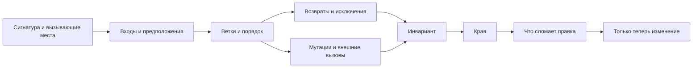

# 07 · Чтение незнакомого кода: инвариант, края, что я сломаю

**Мост:** в [06](./06_pyright.md) мы читали диагностику как путь значения:
от источника через ветки к опасной операции. Незнакомый код читается тем же
способом, только инструмент не сформулирует весь договор за нас. Здесь
соберём ритуал входа в функцию и найдём место, где внешнюю зависимость можно
подменить без переписывания решения. После главы все приёмы M1b сходятся в
домашнем слое Harbor.

**Вопрос сюжета:** как за 10–15 минут понять, что обещает чужая функция,
какие края она скрывает и где безопаснее всего начать изменение?

### С собесов и из продакшена

На собеседовании могут дать короткий фрагмент и спросить, что он делает,
где ошибка и как тестировать. На работе код почти всегда читают чаще, чем
пишут. Самая дорогая привычка — сразу переименовывать и «улучшать стиль»,
не выяснив наблюдаемое поведение: красивый рефакторинг легко меняет порядок,
тип ошибки или момент мутации.

---

## Словарь

| Термин | English | На пальцах |
|--------|---------|------------|
| наблюдаемое поведение | observable behavior | То, что видит вызывающий код: возврат, исключение, мутация, вывод |
| инвариант | invariant | Условие, которое обязано оставаться истинным до и после корректной операции |
| край | edge case | Малый или граничный вход, на котором скрытое предположение становится видимым |
| побочный эффект | side effect | Изменение вне возвращаемого значения: запись в set, файл, БД, лог |
| вызывающий код | caller | Место, которое зависит от сигнатуры и поведения функции |
| зависимость | dependency | Внешний участник, нужный функции: хранилище, часы, сеть, другая функция |
| шов | seam | Точка, где зависимость можно заменить, не переписывая саму бизнес-ветку |
| характеризующий тест | characterization test | Тест, фиксирующий фактическое текущее поведение перед изменением |

Характеризующий тест не утверждает, что старое поведение идеально. Он
создаёт сигнал: если правка изменила результат, мы увидим это и решим
осознанно, было изменение исправлением или случайной поломкой.

---

## Модель чтения: ритуал из трёх вопросов

### 1. Какой инвариант держит код?

Не пересказывайте строки: «идёт цикл, потом if». Сформулируйте договор
предметно:

> После успешного выбора возвращён идентификатор первой вместительной
> свободной комнаты, и эта комната отмечена занятой.

Затем проверьте, действительно ли каждая ветка поддерживает эту фразу.
Инвариант даёт критерий чтения: теперь важны порядок комнат, условие
свободы, момент мутации и результат при отсутствии кандидата.

### 2. Какие края проявят предположения?

Начните с небольшого набора, а не со случайной сотни объектов:

- пустой каталог;
- одна комната ровно нужной вместимости;
- все комнаты заняты;
- первая мала, вторая подходит;
- дубликат идентификатора;
- нулевое или отрицательное число гостей;
- отсутствующее или неверно типизированное поле;
- ошибка во время побочного эффекта.

Край полезен не потому, что «тестов должно быть много». Он заставляет
ответить, где проходит граница договора. Например, вместимость ровно равна
числу гостей: условие должно быть `>=`, а не `>`.

### 3. Что я сломаю этой правкой?

До редактирования перечислите наблюдаемые поверхности:

- кто вызывает функцию и какие аргументы передаёт;
- ожидает ли вызывающий `""`, `None` или исключение;
- зависит ли он от выбора **первой** комнаты;
- рассчитывает ли он на мутацию переданного множества;
- какие конкретные исключения уже ловит;
- импортируется ли функция из публичного модуля.

Этот вопрос не запрещает менять договор. Он превращает скрытую несовместимость
в явное решение и список мест для обновления.

---

## Карта чтения



Не обязательно читать весь репозиторий сверху вниз. Начните с сигнатуры,
одного вызывающего места и одного теста, затем пройдите конкретный путь
данных. Если функция вызывает неизвестного помощника, сначала прочитайте
его договор и только потом углубляйтесь в реализацию, когда без этого
нельзя ответить на текущий вопрос.

---

## Незнакомый фрагмент

Следующий код написан специально для этой главы. Представьте, что он пришёл
в ревью без описания:

```python
def claim_room(
    rows: list[dict[str, object]],
    occupied: set[str],
    guests: int,
) -> str:
    for row in rows:
        room_id = str(row["id"])
        capacity = int(row["capacity"])

        if room_id not in occupied and capacity >= guests:
            occupied.add(room_id)
            return room_id

    return ""
```

!!! exercise "Сначала прочитайте сами"

    Не листайте сразу к разбору. За пять минут запишите:

    1. одно предложение об инварианте;
    2. минимум пять краёв;
    3. все наблюдаемые эффекты;
    4. две правки, которые кажутся безобидными, но могут сломать клиента.

### Первый проход: поверхность

Сигнатура говорит:

- `rows` — список отображений с неизвестными значениями;
- `occupied` — изменяемое множество идентификаторов;
- `guests` — целое число;
- наружу всегда обещана строка.

Но аннотации не отвечают, что означает пустая строка и кто владеет
`occupied`. Ищем возвраты и мутации. Функция либо добавляет id в переданное
множество и возвращает его, либо возвращает `""` без мутации. Уже видны два
канала результата: строка и побочный эффект.

### Второй проход: предполагаемый инвариант

Осторожная формулировка:

> Если в порядке `rows` есть первая комната с вместимостью не меньше
> `guests` и её строкового id нет в `occupied`, функция добавляет id в
> `occupied` и возвращает тот же id. Если кандидата нет, она возвращает
> пустую строку и не меняет множество.

Слово «строкового» важно: `str(row["id"])` превращает `None` в `"None"`, а
число `12` — в `"12"`. Возможно, автор хотел нормализацию; возможно, так
грязные данные маскируются под допустимый id. По одному фрагменту нельзя
выдумать правильную политику — нужно посмотреть вызывающий код, данные и
тесты.

### Третий проход: края

Фрагмент требует решений, которых в нём не видно:

1. `rows == []` и «все заняты» оба дают `""`; различать причины нельзя.
2. `guests == 0` почти любая комната подходит; в Harbor такой запрос,
   вероятно, невалиден.
3. Отсутствующий `"id"` или `"capacity"` бросит `KeyError`.
4. `capacity == "many"` бросит `ValueError` во время `int(...)`.
5. `id is None` тихо становится строкой `"None"`.
6. Два одинаковых id в `rows` считаются одной занятостью, хотя каталог
   может быть повреждён.
7. Если следующий слой ожидал `None`, пустая строка создаёт ложный id.
8. Множество меняется до `return`; клиент мог рассчитывать на эту мутацию.

Не все пункты обязательно являются багами. Это список вопросов к договору.
Например, `KeyError` может быть намеренным сигналом «внутренние данные
повреждены». Плохой рефакторинг поймает `Exception` и вернёт `""`, тем самым
смешав повреждение данных с честным отсутствием комнаты.

### Четвёртый проход: что легко сломать

- Сортировка `rows` «для удобства» изменит понятие первой комнаты.
- Замена `""` на `None` улучшит тип, но сломает клиентов, которые сравнивают
  результат с пустой строкой.
- Удаление `occupied.add` превратит выбор в чтение и позволит выдать ту же
  комнату повторно.
- Перенос `occupied.add` после `return` сделает строку недостижимой.
- Широкий `except Exception: return ""` скроет неверную схему данных.
- Преобразование `occupied` в копию уберёт ожидаемый эффект для вызывающего.

До правки нужно найти хотя бы одно место вызова и тест, а если теста нет —
зафиксировать выбранные текущие случаи характеризующими тестами.

---

## Сухой прогон незнакомой функции

**Вход:**

```python
rows = [
    {"id": "A", "capacity": "4"},
    {"id": "B", "capacity": 8},
    {"id": "C", "capacity": 10},
]
occupied = {"A"}
result = claim_room(rows, occupied, guests=6)
```

1. Первая строка: `room_id == "A"`, `capacity == 4`.
2. `room_id not in occupied` ложно, а вместимость тоже мала; тело `if`
   пропускается.
3. Вторая строка: `room_id == "B"`, `capacity == 8`.
4. B нет в `occupied`, `8 >= 6` истинно.
5. В множество добавляется B. Теперь оно равно `{"A", "B"}`.
6. Возвращается `"B"`; строка C не читается.

**Выход:** `result == "B"` и переданное множество изменено. Если при чтении
заметить только возврат, половина поведения останется невидимой.

---

## Шов: место для безопасной подмены

Шов — не обязательно фреймворк внедрения зависимостей или большая иерархия.
Это место, где реального участника можно заменить управляемым участником,
не меняя проверяемое решение.

В исходной функции `rows` и `occupied` уже передаются параметрами. Благодаря
этому для чтения не нужна настоящая БД: тест может дать маленький список и
множество. Это простейшие швы.

Представим худший вариант:

```python
def claim_room(guests: int) -> str:
    rows = database.execute("SELECT id, capacity FROM rooms").fetchall()
    ...
    database.execute(
        "UPDATE rooms SET occupied = true WHERE id = ?",
        (room_id,),
    )
```

Решение, получение данных и запись сцеплены с глобальным `database`.
Чтобы проверить край «вторая комната подходит», нужен реальный клиент или
опасная подмена глобального имени.

Первый небольшой шов можно сделать вокруг эффекта:

```python
from collections.abc import Callable

MarkOccupied = Callable[[str], None]


def claim_room(
    rows: list[dict[str, object]],
    occupied: set[str],
    guests: int,
    mark_occupied: MarkOccupied,
) -> str:
    for row in rows:
        room_id = str(row["id"])
        capacity = int(row["capacity"])

        if room_id not in occupied and capacity >= guests:
            mark_occupied(room_id)
            return room_id

    return ""
```

В приложении передаётся функция репозитория, которая сохраняет бронь. В
маленьком тесте можно передать `marked.append`:

```python
marked: list[str] = []

result = claim_room(
    rows=[{"id": "B", "capacity": 8}],
    occupied=set(),
    guests=6,
    mark_occupied=marked.append,
)

assert result == "B"
assert marked == ["B"]
```

Такой шов делает эффект наблюдаемым и заменяемым. Но он **меняет договор**
исходной функции: переданное множество больше не обязано мутировать, а
реальная запись может завершиться ошибкой. Перед рефакторингом это нужно
согласовать с вызывающим кодом и закрепить тестами.

Кроме того, «проверить свободно, затем записать» может проиграть гонку двум
процессам. Шов облегчает тестирование, но не делает операцию атомарной.
Надёжное хранилище должно само подтвердить резервирование или отвергнуть
его; конкуренцию разберём в последующих модулях.

Когда операций у зависимости становится несколько, набор отдельных
callback-функций можно заменить маленьким `Protocol`. Делать это заранее
ради слова «архитектура» не нужно: сначала найдите конкретный внешний
эффект, который мешает проверить бизнес-ветку.

---

## Практический порядок перед изменением

1. Прочитайте сигнатуру, все `return`, `raise` и места мутации.
2. Найдите один реальный вызов: он показывает, как понимают договор.
3. Найдите или напишите маленький характеризующий тест.
4. Сформулируйте инвариант одним предложением.
5. Прогоните минимум: пусто, граница, успех не на первом элементе, ошибка
   данных.
6. Запишите, что именно правка намеренно меняет.
7. Создайте минимальный шов только вокруг мешающей зависимости.
8. Запустите тесты и Pyright; сравните не только возврат, но и эффекты.

Если на третьем шаге текущее поведение явно опасно, тест может зафиксировать
его как временный факт с комментарием, а следующим коммитом договор меняется
осознанно. Цель не законсервировать каждый баг, а не потерять информацию о
том, что поменялось.

---

## Упражнение в главе

1. Не переписывая `claim_room`, составьте таблицу из четырёх входов:
   пустой каталог, точная вместимость, неверная строка вместимости и
   подходящая вторая комната. Для каждого предскажите возврат, исключение и
   конечное содержимое `occupied`. Затем выполните код и сверяйте по одному
   пути.
2. Скажите вслух: какой внешний эффект мешал бы тесту, где проходит
   минимальный шов и что изменится в публичном договоре после передачи
   `mark_occupied`. Не предлагайте класс или фреймворк, пока одной функции
   достаточно.

---

## Применение в Harbor

- Перед правкой `allocate` формулируется инвариант «первая подходящая в
  исходном порядке».
- Края включают пустой каталог, равную вместимость, невалидный запрос,
  повреждённую строку и ошибку сохранения.
- Возврат, исключение и мутация считаются тремя отдельными наблюдаемыми
  частями.
- Один вызывающий участок и характеризующий тест читаются до рефакторинга.
- Хранилище или часы передаются через минимальную границу, когда глобальная
  зависимость мешает контролируемому тесту.
- Pyright подтверждает форму путей, но бизнес-инвариант всё равно
  проговаривается человеком.

## Мини-голос

> Незнакомый код сначала читаю, а не улучшаю. Называю инвариант, проверяю
> края и перечисляю возвраты, исключения и мутации. До правки нахожу
> вызывающий код и отвечаю, что могу сломать: порядок, тип результата,
> эффект или ошибку. Шов — минимальная точка подмены зависимости, часто
> обычный параметр. Он облегчает проверку, но сам по себе не исправляет
> бизнес-договор и не решает гонки.

**Домашка пакета:** [задание 7](./homework.md) — письменный разбор
незнакомого фрагмента из вашего Harbor до каких-либо правок.

**Дальше:** [домашка M1b](./homework.md) объединяет ошибочный путь,
генератор, пакет, Pyright и ритуал чтения.

<small>Если захочешь глубже позже: `feathers-legacy`, темы изменений,
обратной связи и швов по
[карте чтения](../../reference/reading-map.md); `oust-psd` — границы
модулей. Это дополнительный взгляд после собственной практики.</small>
