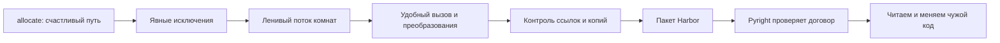

# M1b · Python глубже: от скрипта к поддерживаемому коду

**Откуда пришли:** в [M1](../m1-python/index.md) появились модели комнаты и
запроса, фабрики, аннотации и небольшой `allocate`. Код уже умеет ответить на
счастливый сценарий: найти подходящую переговорку. Теперь пора разобрать, что
происходит на несчастливом пути, как не загружать все данные сразу, как
разделить код на пакеты и как проверить обещания типов настоящим
инструментом.

**Сквозная нить:** команда Harbor превращает учебный файл с `allocate` в
маленький доменный пакет. По дороге отсутствие комнаты получает осмысленную
ошибку, каталог становится ленивым потоком, границы мутации делаются
видимыми, а импорты перестают зависеть от текущей директории. Затем Pyright
проверяет договор моделей, а ритуал чтения помогает безопасно войти в
незнакомый код. К концу M1b вы не просто знаете ещё несколько конструкций
Python: вы можете объяснить путь одного запроса от входных данных до
результата или доменной ошибки.

**Вопрос пакета:** как сделать Python-код Harbor предсказуемым для
вызывающего кода, проверяющего типов и следующего разработчика?

!!! note "Site-first: английская книга не нужна"

    Главы 01–07, упражнения внутри них и [домашка](./homework.md) образуют
    полный русскоязычный маршрут. Все схемы, примеры и фрагменты кода написаны
    для этого курса. Внешние книги упомянуты только как необязательная
    глубина после практики; без них M1b закрывается целиком.

## Одна история в семи шагах

Каждый шаг устраняет конкретную неопределённость. Исключение отвечает, почему
результата нет. Итератор отвечает, когда берётся следующая комната.
Распаковка и включения показывают, как данные входят в функцию и меняют
форму. Копирование отвечает, кто владеет изменяемым объектом. Пакет задаёт
границы имён. Pyright проверяет статический договор, а чтение кода связывает
все эти решения в рабочую привычку.

| Глава | Вопрос сюжета | Практический выход |
|-------|---------------|--------------------|
| [01 · Исключения как часть договора](./01_exceptions.md) | Как отличить ожидаемое отсутствие комнаты от поломки программы? | `NoRoomAvailable`, узкий `except`, понятный путь ошибки |
| [02 · Итераторы и генераторы](./02_iterators_generators.md) | Как проверять комнаты по одной и остановиться сразу после ответа? | понимание `iter`/`next`, генератор подходящих комнат |
| [03 · Аргументы, распаковка и включения](./03_args_comprehensions.md) | Как принять гибкий вызов, не потеряв форму данных и читаемость? | осознанные `*args`/`**kwargs`, распаковка, простые comprehensions |
| [04 · Ссылки, копии и мутация](./04_copy_mutability.md) | Как не изменить каталог через «копию», которая делит вложенные объекты? | модель ссылок, shallow/deep copy, безопасные снимки |
| [05 · Модули и пакеты](./05_packages.md) | Как разложить Harbor по файлам так, чтобы импорты выражали границы? | пакет, `__init__.py`, запуск через `python -m` |
| [06 · Pyright руками](./06_pyright.md) | Как превратить аннотации M1 в проверяемый договор без магии IDE? | самостоятельная установка, запуск и цикл исправления |
| [07 · Чтение незнакомого кода](./07_reading_code.md) | Как войти в чужую функцию и предложить безопасную точку изменения? | ритуал «инвариант → края → что сломаю», идея шва |
| [Домашка](./homework.md) | Можем ли мы собрать всё в одном слое Harbor? | код, тесты, вывод Pyright и письменный разбор |

## Как проходить

Работайте в уже созданных `drills` и `harbor-capstone`. Этот модуль не
создаёт за вас `pyproject.toml`, конфигурацию CI или готовую структуру
пакетов. Сначала глава объясняет, зачем нужен следующий шаг; затем вы сами
печатаете команду, смотрите результат и только после этого продолжаете.

Для каждой главы сохраняйте цикл M0.5:

1. назовите вход, выход и инвариант;
2. предскажите результат примера без запуска;
3. выполните маленький эксперимент;
4. сравните фактический результат с прогнозом;
5. перенесите идею в Harbor только после объяснения расхождения.

## Критерии выхода

M1b закрыт, когда вы можете без подсказки:

- провести успешный и ошибочный путь `allocate`, объяснив, где рождается,
  где перехватывается и где не должна скрываться `NoRoomAvailable`;
- раскрыть `for` через `iter()` и `next()`, написать генератор комнат и
  доказать сухим прогоном, что он ленивый;
- объяснить назначение `*` и `**` в определении и вызове функции, а также
  выбрать обычный цикл вместо нечитаемого включения;
- нарисовать ссылки для присваивания, поверхностной и глубокой копии и
  предсказать мутацию вложенного списка;
- вручную собрать пакет Harbor, запустить его как модуль и обосновать
  направление импортов;
- самостоятельно установить и запустить Pyright, прочитать сообщение как
  путь данных и добиться чистой проверки моделей без бездумного
  `type: ignore`;
- за 10–15 минут разобрать короткую незнакомую функцию по ритуалу
  «инвариант → края → что я сломаю», после чего назвать место для безопасной
  подмены зависимости.

**Короткий гейт:** ошибочный путь явный, поток ленивый, мутация и импорты
предсказуемы, модели Harbor проходят Pyright, незнакомый код разобран
письменно.

## Куда дальше

После M1b продолжите или закончите [M2](../m2-algo-i/index.md) и
[M3](../m3-algo-ii/index.md): там `allocate` получает оценку сложности,
интервалы, поиск и структуры данных. Затем переходите к M4a — машине и ОС.
На этом пути типы Harbor постепенно ужесточаются с Pyright: не одним
глобальным переключателем, а файл за файлом, когда договор уже понятен.

<small>Если после практики захочется глубже, используйте только IDs
`fluent-py`, `oust-psd` и `feathers-legacy` в
[карте чтения](../../reference/reading-map.md). Это дополнение, не условие
прохождения.</small>
